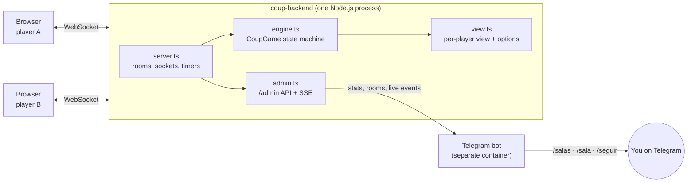

<div align="center">

# Coup Backend

**The authoritative game server behind [coup.freddysaez.es](https://coup.freddysaez.es):
every rule, every shuffle and every bluff is decided here.**

[](https://github.com/freddysae0/coup-backend/actions/workflows/cicd.yml)    


<sub>A live game in the <a href="https://github.com/freddysae0/coup">web client</a>. Everything you see was decided and sent by this server.</sub>

</div>

---

Coup is a bluffing game, which makes it a cheater's dream: if the browser knew
everyone's cards, anyone could peek. So the browser knows nothing. This server
shuffles and deals, validates every move, resolves challenges and blocks, and
sends each player **only their own view** of the table. Clients send intents
like *"I challenge"* or *"I play Tax"* and render what comes back.

## Highlights

- **Authoritative rules engine.** A pure state machine (`src/game/engine.ts`)
  with the full rule set, including the edge cases tables argue about.
- **Per-player views.** Your cards, everybody's revealed cards, and only counts
  for the rest. Each view lists the exact `options` that player has right now.
- **Built for real networks.** Reconnect to your seat with the same id, a grace
  period for dropped players, response windows that auto-pass, and a heartbeat
  that cleans up dead sockets.
- **Observability.** A read-only admin API with live Server-Sent Events, and a
  Telegram bot to follow every room from your phone. It is spectator-safe:
  hidden cards are never exposed.
- **Heavily tested.** 43 tests, including **3000 fuzzed random games** that must
  always finish in a consistent state, and full games played by bots over real
  WebSockets.

## Architecture



## Quick start

Requires Node.js 22.

```bash
npm install
npm run dev          # builds and starts on http://localhost:8000 (WebSocket on the same port)
npm test             # rules tests, 3000 fuzzed games, WebSocket simulations
npm run simulate -- ws://localhost:8000 4   # watch 4 bots play a full game
```

Then run the [web client](https://github.com/freddysae0/coup) with `npm run dev`
and open <http://localhost:3000>.

Or with Docker, the backend and the bot each in their own container:

```bash
cp .env.example .env   # fill it in
docker compose up -d --build
```

## Configuration

| Variable | Default | Meaning |
| --- | --- | --- |
| `PORT` | `8000` | HTTP + WebSocket port (any path works, e.g. `/` or `/ws`) |
| `RESPONSE_TIMEOUT_MS` | `30000` | Time to challenge or block before everyone left auto-passes (`0` = never) |
| `DISCONNECT_GRACE_MS` | `120000` | A player offline this long during a game forfeits (`0` = never) |
| `ADMIN_TOKEN` | (unset) | Enables the read-only `/admin` API (bearer token). Unset means `/admin` is 404 |
| `COMPOSE_PROFILES` | (unset) | Set to `telegram` to start the bot with `docker compose` |
| `TELEGRAM_BOT_TOKEN` | (unset) | Bot token from [@BotFather](https://t.me/BotFather) |
| `TELEGRAM_ALLOWED_CHAT_IDS` | (unset) | Comma-separated chats the bot answers. Anyone else only gets their chat id back |
| `TELEGRAM_FLUSH_MS` | `3000` | Live moves are batched and sent at most this often |

`.env.example` documents every variable.

## Observability

### Admin API

With `ADMIN_TOKEN` set, the backend exposes a read-only API
(header `Authorization: Bearer <ADMIN_TOKEN>`):

| Route | What |
| --- | --- |
| `GET /admin/stats` | Rooms (lobby / playing / gameOver), players online, players in games, games started and finished since boot, uptime |
| `GET /admin/rooms` | Live rooms: phase, players, alive, turn, leader (most cards, then coins), winner, last activity |
| `GET /admin/rooms/:id` | Players (coins, cards left, revealed cards, online, host), turn, pending action, recent log |
| `GET /admin/events` | Server-Sent Events: `log`, `phase`, `gameStarted`, `gameOver`, `roomCreated`, `roomDeleted` (`?room=<id>` filters) |
| `GET /admin/rooms/:id/events` | The same stream for one room |

It is a **spectator** view: face-down cards and player ids (which work as seat
credentials) are never exposed, so you can watch a game you are playing in
without cheating.

### Telegram bot

`src/telegram/` is a separate process built from the same image
(`node dist/telegram/index.js`). It follows the admin event stream and answers,
in Spanish:

| Command | What |
| --- | --- |
| `/stats` | Rooms, players and games right now |
| `/salas` | Live rooms, paginated, with a button to open each one |
| `/sala <id>` | Players, coins, cards left, who is leading, whose turn, last moves |
| `/seguir <id>` · `/dejar [id]` | Follow a room's moves live (batched every few seconds), or stop |
| `/avisos on\|off` | Notify when a game starts or ends |

<details>
<summary>Set it up</summary>

1. In Telegram, talk to [@BotFather](https://t.me/BotFather), send `/newbot`
   and put the token in `TELEGRAM_BOT_TOKEN`.
2. Generate an admin token, e.g. `openssl rand -hex 32`, and set `ADMIN_TOKEN`.
3. Start the bot and send it `/start`. Your chat is not allowed yet, so it
   answers with your chat id: put it in `TELEGRAM_ALLOWED_CHAT_IDS`
   (comma-separated; group ids are negative) and restart the bot.

Without Docker:

```bash
ADMIN_TOKEN=secret npm run dev                      # terminal 1
ADMIN_TOKEN=secret TELEGRAM_BOT_TOKEN=... TELEGRAM_ALLOWED_CHAT_IDS=123 \
  BACKEND_URL=http://localhost:8000 node dist/telegram/index.js   # terminal 2
```

</details>

## Game flow

```
lobby ──start──▶ action ──(Income / Coup / Foreign aid)──────────────┐
                   │                                                  │
                   └─(Tax/Assassinate/Steal/Exchange)─▶ challengeAction
                                                        │ all pass    │ challenge
                                                        ▼             ▼
                            blockAction ◀── action stands ◀── loseInfluence
                     (target, or anyone for Foreign aid)
                       │ all pass          │ block
                       ▼                   ▼
                    resolve         challengeBlock ── all pass ──▶ blocked
                       │                   │ challenge
                       ▼                   ▼
         Coup/Assassinate → loseInfluence  loseInfluence → resolve or blocked
         Exchange → exchange
                       ▼
                  next turn … until one player is left → gameOver ──restart──▶ lobby
```

**Rules covered:**
- the 2-player variant (the first player starts with 1 coin);
- a forced Coup at 10+ coins;
- costs paid on declaration (the Assassin is refunded if caught bluffing);
- a revealed card is replaced from the deck after a won challenge;
- the double loss (failed challenge plus assassination);
- the last card is lost automatically;
- an exchange keeps as many cards as alive influence;
- eliminated players are skipped;
- players can leave at any moment;
- disconnections and reconnections.

## Protocol

Client → server (JSON):

```ts
{type: 'join', room, playerId, name?}   // also used to reconnect to your seat
{type: 'rename', name}
{type: 'start'}                         // host only
{type: 'action', action, targetId?}     // 'Income' | 'Foreign aid' | 'Coup' | 'Tax' | 'Assassinate' | 'Steal' | 'Exchange'
{type: 'challenge', windowId?}
{type: 'block', role, windowId?}
{type: 'pass', windowId?}
{type: 'loseCard', index}
{type: 'exchange', keep: number[]}      // indexes into options.exchange.cards
{type: 'leave'}
{type: 'restart'}                       // host only, after gameOver
{type: 'ping'}
```

Server → client:

```ts
{type: 'state', state: GameView, serverTime, responseTimeoutMs}
{type: 'error', code, message, params?}  // code is stable, message is English
{type: 'left'}
{type: 'pong'}
```

`GameView.options` tells the client exactly what it may do right now, so the
UI never re-implements the rules. Log entries carry a structured `event` next to
the English text, so clients can translate them. Responses that include a
`windowId` and arrive after that window closed (somebody else was faster) are
ignored.

## Project structure

```
src/
├── game/
│   ├── types.ts      Roles, actions (cost, claimed role, who blocks), phases
│   ├── engine.ts     CoupGame: the state machine with all the rules
│   └── view.ts       Per-player view and the options each player has right now
├── server.ts         Rooms, sockets, reconnection, timers, heartbeat
├── admin.ts          Read-only /admin API and live event stream (SSE)
├── telegram/         Telegram bot: commands, formatting, SSE client
├── bot.ts            A client that plays using only its own view
├── simulate.ts       CLI: bots play a full game against any server
├── index.ts          Entry point
└── test/             node:test suites (engine, simulations, admin, bot)
```

## Deployment

Production runs at `wss://coup-back.freddysaez.es` on a [Ploi](https://ploi.io)
server with Docker, next to the [web client](https://github.com/freddysae0/coup).
Every push to `master` runs lint and tests on GitHub Actions; if they pass, Ploi
checks out **that exact commit** and runs `docker compose up -d --build`. Nginx
terminates TLS and proxies HTTP, WebSocket and SSE to the container, which only
listens on `127.0.0.1:8000`.

<details>
<summary>One-time server setup</summary>

1. Let the Ploi user run Docker: `sudo usermod -aG docker ploi`.
2. Create the site `coup-back.freddysaez.es`, install this repository on the
   `master` branch and add a Let's Encrypt certificate. The site needs a
   `public/` folder for the certificate check: `mkdir -p public` in the site
   directory. Leave **Quick deploy off**.
3. Create `.env` in the site directory from `.env.example`. Add
   `COMPOSE_PROFILES=telegram` to run the Telegram bot too.
4. Deploy script. GitHub Actions sends the tested commit as the `SHA` variable;
   a manual deploy from the panel has no `SHA` and takes the tip of `master`:

   ```bash
   set -e
   cd /home/ploi/coup-back.freddysaez.es
   git fetch origin master
   TARGET="${SHA:-origin/master}"
   git merge-base --is-ancestor "$TARGET" origin/master
   git checkout --force --detach "$TARGET"
   docker compose up -d --build --remove-orphans
   docker image prune -f
   echo "Deployed $(git rev-parse --short HEAD)"
   ```

5. Nginx: replace the PHP `location` blocks with a WebSocket and SSE friendly
   proxy, then `nginx -t && systemctl reload nginx`:

   ```nginx
   location / {
       proxy_pass http://127.0.0.1:8000;
       proxy_http_version 1.1;
       proxy_set_header Upgrade $http_upgrade;
       proxy_set_header Connection "upgrade";
       proxy_set_header Host $host;
       proxy_set_header X-Real-IP $remote_addr;
       proxy_set_header X-Forwarded-For $proxy_add_x_forwarded_for;
       proxy_set_header X-Forwarded-Proto $scheme;
       proxy_read_timeout 1h;
       proxy_send_timeout 1h;
       proxy_buffering off;
   }
   ```

   Do not add a `/.well-known/acme-challenge/` location: Ploi already includes
   one, and a duplicate makes `nginx -t` fail.

6. Copy the deploy webhook URL from the site's *Repository* tab into the GitHub
   secret `PLOI_DEPLOY_WEBHOOK`.

</details>

## Credits

Coup was designed by **Rikki Tahta** and is published by **Indie Boards & Cards**.
This is an unofficial, non-commercial fan adaptation, made by
[Freddy Sáez](https://github.com/freddysae0)
([LinkedIn](https://www.linkedin.com/in/freddy-js/)).
